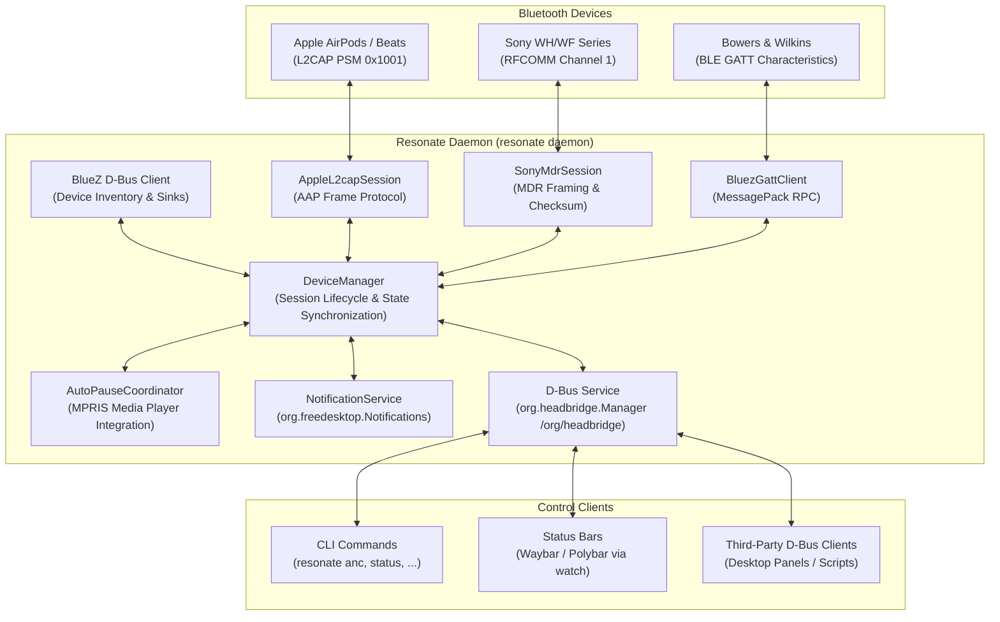

# Resonate

Resonate is a native Linux Bluetooth headphone daemon and CLI providing reverse-engineered, vendor-specific controls for supported **Apple / Beats** (AirPods, AirPods Pro, AirPods Max, Beats), **Sony** (WH-1000XM, WF-1000XM, LinkBuds, MDR), and **Bowers & Wilkins** (Px7, Px8, Pi) wireless headphones.

It brings first-class desktop integration to Linux:
- **Active Noise Cancellation (ANC)** mode toggling (Off, Noise Cancellation, Transparency, Adaptive, Wind Reduction)
- **Detailed battery telemetry** (left bud, right bud, charging case, and charging indicators)
- **Smart auto-pause / auto-resume** via MPRIS when earbuds are removed or re-inserted
- **Hardware-specific settings** (Conversation Awareness, single-bud ANC, mic routing, chime volume, touch panel controls, DSEE, NC optimizer, standby timers, custom action buttons, and hardware equalizers)
- **Status bar streaming** (`resonate watch --format waybar`) for Waybar, Polybar, or custom shell scripts
- **Desktop notifications** via FreeDesktop notifications for low battery alerts and connection status

---

## Table of Contents

- [Supported Hardware](#supported-hardware)
- [Architecture & How It Works](#architecture--how-it-works)
- [Prerequisites & Permissions](#prerequisites--permissions)
- [Installation & Setup](#installation--setup)
- [CLI Command Reference](#cli-command-reference)
- [Status Bar Integration (Waybar & Polybar)](#status-bar-integration-waybar--polybar)
- [D-Bus API Reference](#d-bus-api-reference)
- [Configuration Reference](#configuration-reference)
- [Troubleshooting & FAQ](#troubleshooting--faq)
- [Building & Development](#building--development)
- [License & Attribution](#license--attribution)

---

## Supported Hardware

| Manufacturer | Models | Features Supported |
| :--- | :--- | :--- |
| **Apple** | AirPods Pro (1st, 2nd gen, USB-C, 3rd gen) | ANC / Transparency / Adaptive, Conversation Awareness, Left/Right/Case battery, Single-bud ANC, Ear detection, Mic selection, Chime volume |
| **Apple** | AirPods 4 (Standard & ANC) | ANC / Transparency / Adaptive (ANC model), Case battery, Ear detection, Chime volume |
| **Apple** | AirPods (1st, 2nd, 3rd gen) | Left/Right/Case battery, Ear detection, Mic selection, Spatial Audio flag |
| **Apple** | AirPods Max (Lightning & USB-C) | ANC / Transparency, Battery percentage, Head detection |
| **Beats** | Beats Fit Pro, Beats Studio Buds+, Beats Studio Pro | ANC / Transparency, Left/Right/Case battery, Ear detection, Mic selection |
| **Beats** | Beats Solo 4, Beats Solo Buds | Battery telemetry, Device status |
| **Sony** | WH-1000XM3, WH-1000XM4, WH-1000XM5 | ANC / Ambient Sound (0-20) / Wind Noise, 5-band EQ + Clear Bass, Touch Sensor toggle, DSEE Extreme, NC Atmospheric Optimizer, Auto-Power Off |
| **Sony** | WF-1000XM3, WF-1000XM4, WF-1000XM5, LinkBuds | ANC / Ambient Sound, 5-band EQ + Clear Bass, DSEE Extreme, Touch sensor toggles |
| **Bowers & Wilkins** | Px7 S2, Px7 S2e, Px8, PI7, PI5 | ANC (Off, Auto, Low, High), Bass / Treble tone controls, Wear Sensor, Auto-standby timer, Action button remapping |

---

## Architecture & How It Works

Resonate operates in two tiers:



### Runtime Flow

1. **Daemon Startup**: `resonate daemon` claims the session D-Bus names `org.headbridge` and `org.resonate`, publishing the `org.headbridge.Manager` interface at `/org/headbridge`.
2. **Monitoring Loop**: Every 2.5 seconds, the daemon:
   - Queries `pactl info` for the active default PulseAudio/PipeWire sink.
   - Queries BlueZ `org.bluez.Device1` objects to discover paired and connected Bluetooth audio devices.
   - Detects when a supported headphone connects or disconnects.
3. **Vendor Session Establishment**:
   - **Apple**: Connects an asynchronous non-blocking L2CAP socket directly to the device on PSM `0x1001`, sends protocol handshake packets, negotiates feature flags (`0xD7`), subscribes to real-time telemetry, and auto-enables single-bud ANC.
   - **Sony**: Opens an RFCOMM stream socket on channel 1, completes packet handshake, and maintains alternating sequence bit ACKs.
   - **Bowers & Wilkins**: Locates the vendor GATT characteristics under BlueZ, registers for notifications, and sends MessagePack RPC queries.
4. **State Signals & Broadcasts**: When telemetry arrives (e.g. battery drain, bud removed from ear, mode button clicked on the headphone), the internal `ResonateState` updates and emits a `StateChanged` D-Bus signal with complete JSON.
5. **Smart Auto-Pause**: When in-ear detection detects bud removal, `AutoPauseCoordinator` queries MPRIS (`org.mpris.MediaPlayer2.*`), pauses actively playing players, and records their bus names. Re-inserting the earbuds within 10 minutes automatically resumes playback.

---

## Prerequisites & Permissions

- **Linux Kernel & BlueZ**: Linux 5.x+ with BlueZ 5.50+ installed and running (`systemctl status bluetooth`).
- **Bluetooth Permissions**: Accessing raw Bluetooth sockets (`L2CAP` / `RFCOMM`) requires standard user permissions. On most distributions (Arch, Fedora, Ubuntu, Debian), ensuring your user is part of the `bluetooth` group or having active logind seat sessions is sufficient:
  ```bash
  sudo usermod -aG bluetooth $USER
  ```
- **Audio Stack**: PulseAudio or PipeWire with `pactl` (usually provided by `pulseaudio-utils` or `pipewire-pulse`).
- **Media Player Control**: D-Bus MPRIS-compliant media players (Spotify, Firefox, Chrome, VLC, Rhythmbox, etc.). `playerctl` is optional and used as a fallback.
- **Desktop Notifications**: Any FreeDesktop-compliant notification daemon (Dunst, Mako, SwayNotificationCenter, GNOME, KDE).

---

## Installation & Setup

### Building from Source

Ensure you have Rust and Cargo installed (1.75+ recommended):

```bash
git clone https://github.com/caughtquick/resonate.git
cd resonate
cargo build --release
cp target/release/resonate ~/.cargo/bin/
```

### Systemd User Daemon Setup

Resonate includes built-in commands to install, run, and manage a user-level systemd service:

```bash
# 1. Install and start user systemd unit
resonate daemon install

# 2. Check service status
resonate daemon status

# 3. View live logs
journalctl --user -u resonate.service -f
```

The service unit is created at:
- `~/.config/systemd/user/resonate.service`

Lifecycle commands:
```bash
resonate daemon start      # Start daemon
resonate daemon stop       # Stop daemon
resonate daemon restart    # Restart daemon
resonate daemon uninstall  # Remove systemd user unit
```

---

## CLI Command Reference

### Status & Introspection

#### `resonate` or `resonate status`
Displays the full status of the active headphone session, including connection state, model name, battery breakdown, ANC mode, audio sink, and feature toggles:
```bash
$ resonate
AirPods Pro (2nd gen, USB-C) [Connected]
Vendor:        Apple
Audio Sink:    bluez_output.6C_12_70_3F_8E_AE.1
Battery:       Left: 82% | Right: 85% | Case: 90% (Discharging)
Noise Control: Noise Cancellation
In-Ear Detect: Enabled (In-Ear)
Auto-Pause:    Enabled
Conv. Aware:   Disabled
Mic Mode:      Auto
One-Bud ANC:   Enabled
```

Add `--json` to output machine-readable JSON:
```bash
$ resonate --json status
{
  "connected": true,
  "connectionState": "connected",
  "deviceName": "AirPods Pro (2nd gen, USB-C)",
  "vendor": "Apple",
  "batteryPercent": 85,
  "batteryLeft": 82,
  "batteryRight": 85,
  "batteryCase": 90,
  "isCharging": false,
  "noiseMode": "noise_cancellation",
  "audioSink": "bluez_output.6C_12_70_3F_8E_AE.1",
  "earDetection": true,
  "autoPause": true,
  "inEar": true,
  "inEarPrimary": "in_ear",
  "inEarSecondary": "in_ear",
  "conversationAwareness": false,
  "micMode": "auto",
  "oneBudAnc": true,
  "chimeVolume": 80,
  "standbyMinutes": 0,
  "touchSensor": false,
  "dsee": false,
  "equalizerPreset": ""
}
```

#### `resonate battery`
Quick overview of battery levels across buds and charging case:
```bash
$ resonate battery
Battery: 85%
  Left Bud:   82%
  Right Bud:  85%
  Case:       90%
  Status:     Discharging
```

#### `resonate devices`
Lists all paired Bluetooth audio devices discovered via BlueZ, their support status, and connection state:
```bash
$ resonate devices
Paired Devices:
 * Abhijit's AirPods Pro [6C:12:70:3F:8E:AE] (Apple: AirPods Pro (2nd gen, USB-C)) - Connected
   WH-1000XM4            [38:18:4C:BE:22:90] (Sony: WH-1000XM4) - Paired
```

#### `resonate connect [target]` & `resonate disconnect`
Connects to or disconnects from a supported headphone by address or name substring:
```bash
resonate connect "AirPods"
resonate connect "6C:12:70:3F:8E:AE"
resonate disconnect
```

---

### Audio & Listening Mode Controls

#### `resonate anc [mode]`
Gets or sets the active noise cancellation / listening mode.
Supported modes: `off`, `anc` (or `nc`), `ambient` (or `transparency`), `adaptive`, `wind`.

```bash
# Query current mode
resonate anc

# Switch modes
resonate anc anc
resonate anc transparency
resonate anc adaptive
resonate anc off
```

#### `resonate ambient-level [0-20]` (Sony)
Adjusts the ambient transparency level on Sony WH/WF headphones:
```bash
resonate ambient-level 12
```

#### `resonate eq [args...]`
Configures equalizers:
- **Sony**: Pass a preset name (`off`, `bright`, `excited`, `mellow`, `relaxed`, `vocal`, `treble_boost`, `bass_boost`, `speech`, `manual`, `custom1`, `custom2`) or 6 integer band gains:
  ```bash
  resonate eq excited
  resonate eq 0 2 4 2 0 3    # 400Hz, 1kHz, 2.5kHz, 6.3kHz, 16kHz, Clear Bass
  ```
- **Bowers & Wilkins**: Pass bass and treble decibel offsets (-6 to +6 dB):
  ```bash
  resonate eq 3 -1           # Bass: +3 dB, Treble: -1 dB
  ```

#### `resonate optimize [start|stop|status]` (Sony)
Controls NC optimizer and barometric pressure calibration:
```bash
resonate optimize start
```

---

### Hardware Toggles & Settings

#### `resonate auto-pause [on|off]`
Toggles Resonate's smart auto-pause and auto-resume behavior when earbuds are taken out or replaced.

#### `resonate wear-sensor [on|off]`
Enables or disables hardware in-ear wear sensors (Apple, B&W).

#### `resonate conv-aware [on|off]`
Enables or disables Conversation Awareness on AirPods Pro 2 / AirPods 4 ANC.

#### `resonate mic [auto|left|right]`
Configures active microphone selection for dual-bud Apple accessories.

#### `resonate one-bud-anc [on|off]`
Allows active noise cancellation to remain active even when only one earbud is worn.

#### `resonate chime [0-100]`
Sets the volume of the charging case speaker and bud alert tones (AirPods Pro 2).

#### `resonate touch [on|off]` (Sony)
Enables or disables the touch control sensor panel on the side of Sony headphones.

#### `resonate dsee [on|off]` (Sony)
Enables or disables Sony DSEE Extreme audio upscaling.

#### `resonate standby [minutes]` (Sony, B&W)
Sets the auto-power off / sleep timer.

#### `resonate button [anc|voice]` (B&W)
Remaps the physical action button on Bowers & Wilkins headphones.

---

### Shell Completions

Generate shell completion scripts for Bash, Zsh, or Fish:

```bash
# Bash
resonate completion bash > ~/.local/share/bash-completion/completions/resonate

# Zsh
resonate completion zsh > ~/.zsh/completion/_resonate

# Fish
resonate completion fish > ~/.config/fish/completions/resonate.fish
```

---

## Status Bar Integration (Waybar & Polybar)

Resonate provides continuous JSON event streaming optimized for status bar widgets:

```bash
resonate watch --format waybar
```

### Output Format

```json
{
  "text": " 85% [ANC]",
  "alt": "connected",
  "tooltip": "AirPods Pro (2nd gen, USB-C)\nBattery: Left: 82% | Right: 85% | Case: 90%\nMode: Noise Cancellation\nSink: bluez_output.6C_12_70_3F_8E_AE.1",
  "class": "connected",
  "percentage": 85
}
```

### Waybar Configuration Example

In `~/.config/waybar/config`:

```json
"custom/resonate": {
    "format": " {icon} {}",
    "format-icons": {
        "connected": "󰋋",
        "disconnected": "󰟎"
    },
    "return-type": "json",
    "exec": "resonate watch --format waybar",
    "on-click": "resonate anc anc || resonate anc transparency",
    "on-click-right": "resonate anc off",
    "on-click-middle": "resonate disconnect"
}
```

In `~/.config/waybar/style.css`:

```css
#custom-resonate {
    padding: 0 10px;
    color: #89b4fa;
}

#custom-resonate.connected {
    color: #a6e3a1;
}

#custom-resonate.disconnected {
    color: #6c7086;
}
```

---

## D-Bus API Reference

Resonate exposes its interface over session D-Bus:

- **Bus Names**: `org.headbridge`, `org.resonate`
- **Object Path**: `/org/headbridge`
- **Interface**: `org.headbridge.Manager`

### Methods

| Method | Signature | Description |
| :--- | :--- | :--- |
| `GetStatus` | `() -> (s)` | Returns complete state formatted as JSON string |
| `ListDevices` | `() -> (s)` | Returns paired devices list as JSON string |
| `Connect` | `(s target) -> (b, s)` | Connects to device by name or MAC address |
| `Disconnect` | `() -> (b)` | Disconnects the active session |
| `SetAnc` | `(s mode) -> (b, s)` | Sets ANC mode (`"off"`, `"anc"`, `"ambient"`, `"adaptive"`, `"wind"`) |
| `SetAmbientLevel` | `(i level) -> (b)` | Sets Sony ambient transparency level (0-20) |
| `SetEqualizer` | `(s args) -> (b, s)` | Configures EQ preset or frequency band string |
| `SetWearSensor` | `(b enable) -> (b)` | Enables or disables hardware wear detection |
| `SetAutoPause` | `(b enable) -> (b)` | Enables or disables software smart auto-pause |
| `GetAutoPause` | `() -> (b)` | Queries smart auto-pause setting |
| `SetConversationAwareness` | `(b enable) -> (b)` | Toggles Conversation Awareness |
| `SetMicrophoneMode` | `(s mode) -> (b)` | Configures mic routing (`"auto"`, `"left"`, `"right"`) |
| `SetOneBudAnc` | `(b enable) -> (b)` | Toggles single-bud ANC permission |
| `SetChimeVolume` | `(y vol) -> (b)` | Sets chime volume (0-100) |
| `SetTouchSensor` | `(b enable) -> (b)` | Enables or disables Sony touch panel |
| `SetDsee` | `(b enable) -> (b)` | Enables or disables Sony DSEE upscaling |
| `SetStandby` | `(s val) -> (b)` | Sets auto-power off timer |
| `SetActionButton` | `(s action) -> (b, s)` | Remaps B&W action button (`"anc"`, `"voice"`) |
| `Optimize` | `(s action) -> (b, s)` | Controls Sony atmospheric pressure optimizer |

### Properties

| Property | Type | Description |
| :--- | :--- | :--- |
| `Connected` | `bool` | True if a supported session is communicating |
| `DeviceName` | `string` | Friendly product name |
| `Vendor` | `string` | `"Apple"`, `"Sony"`, `"Bowers & Wilkins"`, or `"Unknown"` |
| `BatteryPercent` | `int32` | Overall or primary battery percentage (-1 if unknown) |
| `BatteryLeft` | `int32` | Left earbud battery percentage |
| `BatteryRight` | `int32` | Right earbud battery percentage |
| `BatteryCase` | `int32` | Charging case battery percentage |
| `IsCharging` | `bool` | True if any component is actively charging |
| `NoiseMode` | `string` | Active listening mode (`"noise_cancellation"`, `"transparency"`, etc.) |
| `InEar` | `bool` | True if earbuds are inserted in ears |
| `AudioSink` | `string` | Current PipeWire / PulseAudio sink name |

### Signals

- `StateChanged(s json)`: Broadcast whenever telemetry, battery levels, or settings change.

### Inspecting via `busctl`

```bash
# Query status property
busctl --user get-property org.headbridge /org/headbridge org.headbridge.Manager NoiseMode

# Call method
busctl --user call org.headbridge /org/headbridge org.headbridge.Manager SetAnc s "anc"

# Monitor real-time state changes
busctl --user monitor org.headbridge
```

---

## Configuration Reference

Resonate stores user preferences and cached battery states in:
- `$XDG_CONFIG_HOME/resonate/settings.json` (defaults to `~/.config/resonate/settings.json`)

### File Schema Example

```json
{
  "notifications_enabled": true,
  "auto_pause_enabled": true,
  "cached_case_batteries": {
    "6C:12:70:3F:8E:AE": 90
  },
  "preferred_noise_modes": {
    "6C:12:70:3F:8E:AE": "noise_cancellation"
  }
}
```

- `notifications_enabled`: Enables desktop notifications for connection and battery alerts (default: `true`).
- `auto_pause_enabled`: Enables smart auto-pause / auto-resume when earbuds are removed or inserted (default: `true`).
- `cached_case_batteries`: Maps device MAC address to the last reported case battery level so it remains available in status bars even when the case lid is closed and the case radio enters sleep.
- `preferred_noise_modes`: Remembers the user's preferred listening mode to restore across reconnects.

---

## Troubleshooting & FAQ

### 1. "Cannot connect to Resonate daemon over D-Bus"
Make sure the daemon is running in the background:
```bash
resonate daemon status
# If inactive:
resonate daemon start
```

### 2. "AirPods connect to Linux audio, but Resonate doesn't show battery or ANC"
Ensure the Apple L2CAP control channel is established. Some distributions or kernel versions restrict raw L2CAP seqpacket socket creation without appropriate capabilities. Add your user to the `bluetooth` group:
```bash
sudo usermod -aG bluetooth $USER
```
Then log out and log back in.

### 3. "Noise cancellation doesn't turn on when wearing only one earbud"
By default, Apple firmware disables ANC when only one earbud is worn unless "Noise Cancellation with One AirPod" is enabled. Resonate automatically enables this setting upon session connection (`OneBudAnc = 1`), but you can also verify with:
```bash
resonate one-bud-anc on
```

### 4. "Case battery shows null / not reported"
AirPods charging cases only power on their Bluetooth transmitter when the case lid is open or when earbuds are actively docking/undocking. Resonate caches the last observed case battery percentage and continues serving it from `settings.json`.

---

## Building & Development

### Running Tests

```bash
cargo test
```

### Generating Documentation

```bash
cargo doc --no-deps --open
```

### Code Formatting & Linting

```bash
cargo fmt --check
cargo clippy --all-targets --all-features
```

---

## License & Attribution

Resonate is distributed under the [MIT License](LICENSE).

### Attribution

Resonate is derived from and inspired by [HeadBridge](https://github.com/herenickname/HeadBridge) (Copyright &copy; 2026 HeadBridge contributors), adapting its Bluetooth headphone protocol research and reverse engineering (especially for Bowers & Wilkins BLE RPC and Sony MDR protocols, along with maintaining D-Bus interface compatibility under `org.headbridge`) for native Linux environments.

