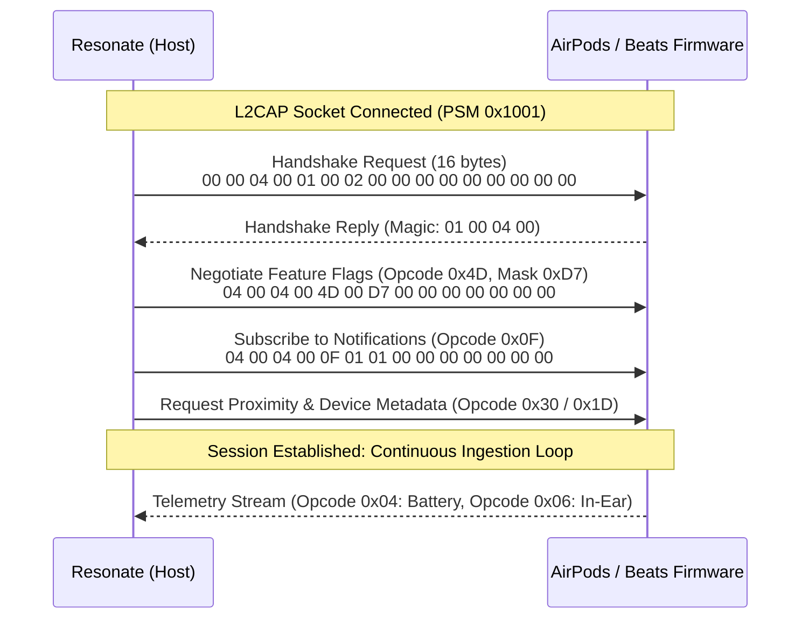

# Resonate Protocol Specifications

This document provides a comprehensive reverse-engineered specification of the proprietary wireless headphone protocols implemented in Resonate:

1. **Apple Accessory Protocol (AAP)** over L2CAP (AirPods, AirPods Pro, AirPods Max, Beats)
2. **Bowers & Wilkins Bluetooth Low Energy RPC** over GATT (Px7 S2, Px7 S2e, Px8, Px7 S3, PI5, PI7)

---

## 1. Apple Accessory Protocol (AAP)

### 1.1 Transport Layer

AirPods and Beats headphones operate standard Bluetooth Classic profiles (A2DP for high-definition audio sink, HFP/HSP for microphone and hands-free control, and AVRCP for media controls). All vendor-specific controls (active noise cancellation, battery percentages for individual earbuds and case, in-ear detection, Conversation Awareness, chime volumes, and settings) run over a separate, connection-oriented **L2CAP** (Logical Link Control and Adaptation Protocol) channel.

| Property | Value |
| :--- | :--- |
| **Address Family** | `AF_BLUETOOTH` (31) |
| **Socket Type** | `SOCK_SEQPACKET` (Preserves packet boundaries) |
| **Protocol** | `BTPROTO_L2CAP` (0) |
| **PSM (Protocol / Service Multiplexer)** | `0x1001` (`AAP_PSM`) |

#### Connection Initialization
Opening the socket requires creating a `libc::socket(AF_BLUETOOTH, SOCK_SEQPACKET, BTPROTO_L2CAP)` descriptor, converting the remote device MAC address to little-endian bytes (`sockaddr_l2`), and issuing a standard asynchronous non-blocking `connect()` system call.

---

### 1.2 Framing & Header Structure

Every AAP packet transmitted or received begins with a 4-byte magic preamble:

```
+-----------------------------------+---------+------------+--------------------+
| Magic Bytes                       | Opcode  | Sub-Opcode | Payload Data       |
| 4 Bytes                           | 1 Byte  | 1 Byte     | Variable Length    |
+-----------------------------------+---------+------------+--------------------+
| 0x04  0x00  0x04  0x00            | 0xNN    | 0xNN       | ...                |
+-----------------------------------+---------+------------+--------------------+
```

- **Standard Magic**: `[0x04, 0x00, 0x04, 0x00]` (used for all request packets and incoming notifications).
- **Handshake Response Magic**: `[0x01, 0x00, 0x04, 0x00]` (sent by AirPods in direct response to the initial connection handshake).

---

### 1.3 Connection Handshake Sequence

Upon connecting the L2CAP socket, Resonate executes a strict handshake:



1. **Initial Handshake (`HANDSHAKE_RAW_BYTES`)**:
   ```hex
   00 00 04 00 01 00 02 00 00 00 00 00 00 00 00 00
   ```
2. **Feature Negotiation (`SET_FEATURES_PRO2_BYTES`)**:
   ```hex
   04 00 04 00 4D 00 D7 00 00 00 00 00 00 00
   ```
   Bitmask `0xD7` advertises host capability for advanced AirPods Pro 2 / AirPods 4 ANC features, including Conversation Awareness, adaptive audio attenuation, and chime controls.
3. **Notification Subscription (`SUBSCRIBE_NOTIFICATIONS_BYTES`)**:
   ```hex
   04 00 04 00 0F 01 01 00 00 00 00 00 00 00
   ```
   Instructs the firmware to push real-time updates whenever battery states, wear status, or physical button toggles change.

---

### 1.4 Opcode Reference

| Opcode | Name | Direction | Description |
| :--- | :--- | :--- | :--- |
| `0x00` | `Handshake` | Host -> Device | Initial session handshake |
| `0x04` | `Battery` | Device -> Host | Multi-component battery telemetry (left bud, right bud, case) |
| `0x06` | `EarDetection` | Device -> Host | In-ear status updates (inserted, removed, in case) |
| `0x09` | `Settings` | Bidirectional | Read, write, or notify configuration settings |
| `0x0F` | `SubscribeNotif` | Host -> Device | Event notification subscription |
| `0x1A` | `Rename` | Host -> Device | Rename Bluetooth accessory |
| `0x1D` | `Metadata` | Device -> Host | Firmware version, hardware revision, serial numbers |
| `0x30` | `RequestInfo` | Host -> Device | Request cryptographic proximity keys or device info |
| `0x31` | `ProximityKeys` | Device -> Host | Proximity pairing keys (IRK, ENC) |
| `0x4B` | `ConvAwarenessLvl` | Device -> Host | Conversation Awareness volume attenuation telemetry |
| `0x4D` | `FeatureFlags` | Host -> Device | Feature capability negotiation bitmask |

---

### 1.5 Payload Decoding

#### Opcode `0x04`: Multi-Component Battery Telemetry
The payload begins with a length indicator followed by component blocks. Each component reports:
- **Kind**:
  - `0x01`: Left Earbud
  - `0x02`: Right Earbud
  - `0x04`: Charging Case
  - `0x08`: Single / Combined Battery (e.g. AirPods Max, Beats Solo)
- **Level**: Integer percentage (`0` to `100`). A value of `0xFF` or `127` indicates unknown / unavailable.
- **Charging State**: Bitflag where bit `0x01` is set if actively charging.

#### Opcode `0x06`: In-Ear Wear Detection
The payload encodes the status of primary and secondary buds:
- `0x01`: Out of ear (removed)
- `0x02`: In ear (inserted)
- `0x03`: Inside charging case

#### Opcode `0x09`: Hardware Settings
Settings packets use opcode `0x09`. Writes format as:
```
[0x04, 0x00, 0x04, 0x00, 0x09, 0x00, SettingId, Length, ValueBytes...]
```

Configurable `SettingId` values:
| `SettingId` | Name | Values / Encoding |
| :--- | :--- | :--- |
| `0x01` | `MicMode` | `0 = Auto`, `1 = Always Right`, `2 = Always Left` |
| `0x0A` | `EarDetection` | `1 = Enabled`, `2 = Disabled` |
| `0x0D` | `NoiseControl` | `1 = Off`, `2 = Noise Cancellation`, `3 = Transparency`, `4 = Adaptive` |
| `0x1B` | `OneBudAnc` | `1 = Enabled`, `2 = Disabled` |
| `0x1F` | `ChimeVolume` | `0..=100` (Case speaker tone volume) |
| `0x28` | `ConvAware` | `1 = Enabled`, `2 = Disabled` |
| `0x29` | `AdaptiveVolume` | `0..=100` (Dynamic attenuation baseline) |

---

## 2. Bowers & Wilkins BLE RPC Protocol

### 2.1 Transport Layer & GATT Services

Bowers & Wilkins headphones (Px7 S2, Px7 S2e, Px8, Px7 S3, PI5, PI7) expose a custom Bluetooth Low Energy (BLE) GATT service. Resonate talks directly to BlueZ's D-Bus `org.bluez.GattCharacteristic1` interfaces.

| Characteristic | 128-bit UUID | Purpose |
| :--- | :--- | :--- |
| **Request / Write** | `ada50ce9-67b8-4a97-9d8e-37e1d083156c` | Host sends RPC requests |
| **Response / Read** | `cb909093-3559-4b0c-9a7f-3f1773122fdc` | Host reads synchronous command results |
| **Notification** | `df55d475-9a32-457a-9e20-38cf14e853fb` | Device pushes asynchronous event notifications |

---

### 2.2 RPC Frame Layout

Each message consists of an 8-byte binary framing header followed by a **MessagePack (rmp)** encoded payload:

```
 0                   1                   2                   3
 0 1 2 3 4 5 6 7 8 9 0 1 2 3 4 5 6 7 8 9 0 1 2 3 4 5 6 7 8 9 0 1
+-+-+-+-+-+-+-+-+-+-+-+-+-+-+-+-+-+-+-+-+-+-+-+-+-+-+-+-+-+-+-+-+
|  Msg Type     |  Sequence     |  Command ID   |  Namespace    |
+-+-+-+-+-+-+-+-+-+-+-+-+-+-+-+-+-+-+-+-+-+-+-+-+-+-+-+-+-+-+-+-+
|  Error Code   |  Reserved/Flags|   Payload Length (16-bit LE) |
+-+-+-+-+-+-+-+-+-+-+-+-+-+-+-+-+-+-+-+-+-+-+-+-+-+-+-+-+-+-+-+-+
|                                                               |
|        MessagePack Serialized Payload (Variable Length)       |
|                                                               |
+-+-+-+-+-+-+-+-+-+-+-+-+-+-+-+-+-+-+-+-+-+-+-+-+-+-+-+-+-+-+-+-+
```

- **Msg Type**:
  - `0x00`: Request with payload
  - `0x0B`: Request without payload
  - `0x0C`: RPC Response
  - `0x0D`: Asynchronous Event Notification
- **Sequence**: Monotonically incrementing byte (`0x00..=0xFF`).
- **Command ID & Namespace**: Command pair identifying the RPC function.
- **Error Code**: `0x00` on success; non-zero on failure (e.g. `0x06` = invalid parameter).
- **Payload Length**: 16-bit unsigned integer formatted little-endian.

---

### 2.3 Command Catalog

```
Namespace 0x02: System & Power
  0x02:0x05  Set Sleep / Auto-Standby Timer
  0x02:0x06  Query Sleep / Auto-Standby Timer

Namespace 0x03: Noise Cancellation
  0x03:0x01  Query Active ANC Mode
  0x03:0x02  Set Active ANC Mode

Namespace 0x04: Audio & Tone Controls
  0x04:0x08  Set Voice Prompts (Enabled / Disabled)
  0x04:0x09  Query Voice Prompts
  0x04:0x17  Set Bass Gain
  0x04:0x18  Query Bass Gain
  0x04:0x19  Set Treble Gain
  0x04:0x1A  Query Treble Gain
  0x04:0x29  Set 5-Band Equalizer Gains
  0x04:0x2A  Query 5-Band Equalizer Gains
  0x04:0x2B  Set Equalizer Bypass
  0x04:0x2C  Query Equalizer Bypass

Namespace 0x05: Multipoint Bluetooth Management
  0x05:0x0B  Query Paired Device Count
  0x05:0x04  Query Paired Device Record by Index
  0x05:0x05  Connect Paired Device by Index
  0x05:0x06  Disconnect Paired Device by Index
  0x05:0x07  Remove Paired Device Record by Index

Namespace 0x08: Device Telemetry & Physical Buttons
  0x08:0x0B  Query Charging Status
  0x08:0x0C  Query Battery Percentage
  0x08:0x2A  Set Custom Action Button Function
  0x08:0x2B  Query Custom Action Button Function

Namespace 0x0A: Wear Sensors
  0x0A:0x01  Query Wear Sensor State
  0x0A:0x02  Set Wear Sensor State
  0x0A:0x03  Query Wear Sensor Sensitivity
  0x0A:0x04  Set Wear Sensor Sensitivity
```

---

### 2.4 ANC Wire Profiles

Firmware implementations differ in wire enum values for ANC across hardware revisions:

| Profile | Target Models | Off | Noise Cancellation | Transparency / Pass-through |
| :--- | :--- | :---: | :---: | :---: |
| **`Standard`** | Px7 S3 | `0` | `1` | `2` |
| **`OriginalPx8`** | Px7 S2, Px7 S2e, Px8 | `1` | `2` | `3` |

> [!IMPORTANT]
> Sending `0` to Px8 or Px7 S2/S2e results in device error `6` (Invalid argument). Resonate automatically inspects the device model and applies the correct wire profile.

---

### 2.5 Tone Controls & 5-Band Equalizer

- **Gain Resolution**: Values are encoded in tenths of a decibel (`0.1 dB`).
  - Wire value `+20` = `+2.0 dB`
  - Wire value `-15` = `-1.5 dB`
  - Valid range: `[-60, 60]`, corresponding to `[-6.0 dB, +6.0 dB]`.
- **2-Band Tone Controls**: Px7 S2, Px7 S2e, and Px8 use commands `0x04:0x17` (Bass) and `0x04:0x19` (Treble).
- **5-Band Parametric Equalizer**: Px7 S3 uses command `0x04:0x29` passing an array of 5 integers: `[band0, band1, band2, band3, band4]`.

---

### 2.6 Multipoint Paired Devices Query

To retrieve the paired device inventory:
1. Resonate issues `0x05:0x0B` to query device count `N`.
2. For each index `i` from `0` to `N - 1`, Resonate issues `0x05:0x04` with payload `i`.
3. The response payload decodes into a MessagePack map:
   - Key `1`: 6-byte Bluetooth MAC address (as binary string or byte array)
   - Key `2`: Friendly name string (e.g. `"MacBook Pro"`)
   - Key `3`: Boolean connection indicator (`true` if currently connected)

---

### 2.7 Multipoint Connect & Disconnect Commands

To connect to or disconnect from a paired device:
1. Resonate builds a BWRPC request for `PAIRED_DEVICE_CONNECT` (`0x05:0x05`) or `PAIRED_DEVICE_DISCONNECT` (`0x05:0x06`) with the target slot index serialized as a MsgPack `u8`.
2. When the headphone firmware replies with success, Resonate waits 300 ms and re-queries `0x05:0x0B` to refresh the paired device state cache.

---

### 2.8 Wear Sensor Telemetry & Sensitivity

- **Real-Time Asynchronous Notifications**: The firmware emits notifications on `0x0A:0x01` / `0x0A:0x02` carrying a boolean (`true` = on-head, `false` = off-head). Resonate updates runtime state `in_ear` and triggers `AutoPauseCoordinator::on_wear_sensor_update` with a 400 ms debounce window to avoid spurious pause/resume triggers.
- **Wear Sensitivity**: Queried with `0x0A:0x03` and set with `0x0A:0x04`:
  - `0`: Low sensitivity
  - `1`: Normal / Medium sensitivity
  - `2`: High sensitivity

---

## 3. Protocol Debugging & Packet Inspection

To capture and inspect live packets on Linux:

### Monitoring Bluetooth Packets (`btmon`)
```bash
sudo btmon -w resonate_trace.pcapng
```
Open `resonate_trace.pcapng` in Wireshark and filter by:
- `bthci_cmd` or `bthci_evt` for connection events
- `btl2cap.psm == 0x1001` for Apple AAP frames
- `btatt` for Bowers & Wilkins GATT RPC exchanges

### D-Bus Monitoring (`busctl`)
```bash
# Monitor BlueZ GATT attribute notifications
busctl --system monitor org.bluez

# Monitor Resonate internal IPC signals
busctl --user monitor org.headbridge
```
